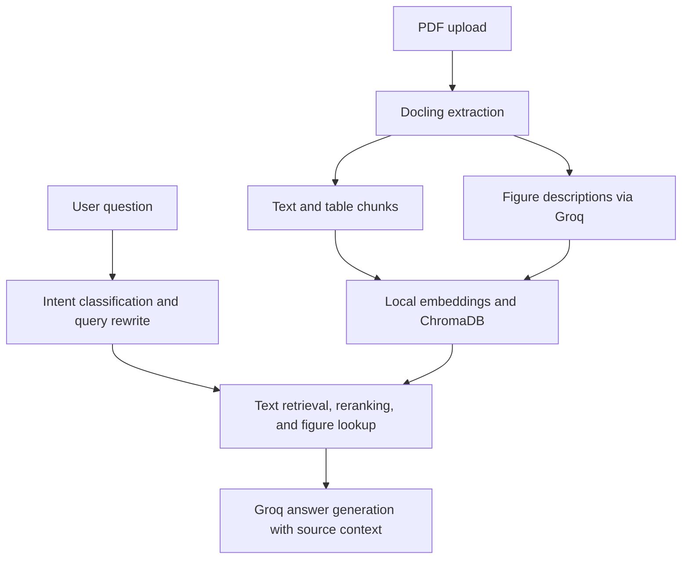

# DocuLens

**PDF question answering with text and chart retrieval.**

DocuLens is a Python/FastAPI backend that retrieves evidence from uploaded PDFs and uses a language model to answer questions. It combines page-aware text and table indexing, cross-encoder reranking, and vision-assisted figure indexing. Answers include retrieved sources and prompts request document/page citations.

> **Status:** Working backend API. There is no frontend in this repository.

## Features

- **Structured PDF extraction:** Docling extracts document text and table content.
- **Page-aware chunking:** Semantic sentence grouping followed by recursive splitting preserves page metadata.
- **Two-stage text retrieval:** MiniLM embeddings retrieve candidates from ChromaDB; a cross-encoder reranks them.
- **Vision-assisted chart indexing:** Figure images are described through Groq vision models and indexed as searchable text.
- **Figure retrieval:** Exact figure IDs, text-to-page lookup, and semantic search retrieve chart descriptions.
- **Query routing:** A Groq model classifies and rewrites factual, analysis, and chart questions.
- **Source metadata:** API responses contain filenames, page numbers, scores, and short evidence snippets.
- **Background ingestion:** Upload requests schedule PDF processing without waiting for completion.

This is retrieval-augmented generation (RAG). It uses pretrained models; it does not train or fine-tune an LLM.

## Architecture



**Ingestion:** PDF → structured extraction → page-aware chunks and figure descriptions → embeddings → separate text/chart collections.

**Question answering:** question → intent classification and rewrite → evidence retrieval → source-tagged context → answer generation.

Chart images are interpreted during ingestion. Question answering retrieves their generated descriptions; it does not pass original chart images to the answer model.

## Technology

| Component | Implementation |
| --- | --- |
| API | FastAPI, Pydantic, Uvicorn |
| PDF parsing | Docling |
| Sentence splitting | NLTK |
| Recursive splitting | LangChain text splitters |
| Embeddings | `sentence-transformers/all-MiniLM-L6-v2` |
| Reranking | `cross-encoder/ms-marco-MiniLM-L-6-v2` |
| Vector storage | Persistent ChromaDB |
| Query routing | Groq `llama-3.1-8b-instant` |
| Answer generation | Groq `llama-3.3-70b-versatile` |
| Vision | Groq Scout, with Maverick fallback |
| Deployment configuration | Docker and Render |

Model IDs describe the current source configuration. Check availability in your Groq account before running.

## Project structure

| Path | Purpose |
| --- | --- |
| `app/main.py` | Application lifecycle, routers, CORS, health endpoint |
| `app/config.py` | Settings and model configuration |
| `app/core/resources.py` | Shared model and database resources |
| `app/models/schemas.py` | API request and response schemas |
| `app/routes/documents.py` | Upload, list, and clear endpoints |
| `app/routes/chat.py` | Retrieval and generation orchestration |
| `app/services/ingestion.py` | Page-aware semantic and recursive chunking |
| `app/services/embedding.py` | Text embedding and Chroma operations |
| `app/services/retrieval.py` | Vector search and cross-encoder reranking |
| `app/services/llm.py` | Groq requests and prompts |
| `app/charts/ingestor.py` | Figure extraction, labeling, and vision descriptions |
| `app/charts/retriever.py` | Figure lookup and semantic chart retrieval |
| `app/services/pdf_processor.py` | Alternative extraction helper; inactive in upload flow |

## Local setup

### Prerequisites

- Python 3.11.
- A Groq API key with access to the configured models.
- Network access for initial model and NLTK downloads.
- An NVIDIA/CUDA environment for the active Docling upload pipeline as currently configured. Embedding and reranking models can choose CPU/MPS/CUDA, but the upload route explicitly selects CUDA.

```bash
git clone https://github.com/pratham-yuxo/doculens-rag.git
cd doculens-rag
python -m venv .venv
```

Activate the environment:

```bash
# macOS/Linux
source .venv/bin/activate
```

```powershell
# Windows PowerShell
.\.venv\Scripts\Activate.ps1
```

Install dependencies:

```bash
python -m pip install --upgrade pip
python -m pip install -r requirements.txt
```

Create a `.env` file in the repository root:

```dotenv
GROQ_API_KEY=your_groq_api_key
CHROMA_DB_PATH=./db/chroma_db
ENABLE_CHARTS=true
```

Keep real credentials out of Git. Setting `ENABLE_CHARTS=false` skips vision processing and chart retrieval, but does not remove the upload route's CUDA requirement.

Start the API from the repository root:

```bash
python -m uvicorn app.main:app --host 127.0.0.1 --port 8000
```

- Swagger UI: [http://127.0.0.1:8000/docs](http://127.0.0.1:8000/docs)
- Health endpoint: [http://127.0.0.1:8000/health](http://127.0.0.1:8000/health)

Startup loads shared models and database resources. Initial startup may download resources.

## API usage

Examples below use Bash-compatible syntax. In PowerShell, use Swagger UI or adapt the quoting for `curl.exe`.

### Upload a PDF

```bash
curl -X POST http://127.0.0.1:8000/documents/upload \
  -F "file=@./sample.pdf"
```

A successful upload response means processing was **scheduled**, not that indexing finished. Inspect server logs for progress and failures. There is currently no ingestion-status endpoint.

### List indexed documents

```bash
curl http://127.0.0.1:8000/documents/list
```

The reported page count counts pages represented in indexed text, rather than necessarily the PDF's total pages.

### Ask a question

```bash
curl -X POST http://127.0.0.1:8000/chat/query \
  -H "Content-Type: application/json" \
  -d '{"question":"What are the main findings?","history":[],"top_k":5}'
```

For a figure question, try a reference present in your uploaded PDF, such as `Explain Figure 2.1`.

| Response field | Meaning |
| --- | --- |
| `answer` | Generated answer or error/refusal text |
| `sources` | Retrieved evidence metadata and snippets |
| `refused` | Whether the route's retrieval gate refused the request |
| `intent` | Query classification |
| `reasoning` | Retrieval diagnostics; not model chain-of-thought |

### Clear indexed text

```bash
curl -X DELETE http://127.0.0.1:8000/documents/clear
```

**Current limitation:** this clears the text collection only. The separate chart collection remains.

## Retrieval defaults

| Setting | Value |
| --- | --- |
| Recursive chunk size | 800 characters |
| Chunk overlap | 120 characters within semantic groups |
| Semantic boundary percentile | 90 |
| Default text results | 5 |
| Initial text candidates | `20 × top_k` |
| Factual refusal threshold | 0.45 on sigmoid-transformed cross-encoder scores |
| History supplied to answer model | Last two messages |

These scores are relevance heuristics, not calibrated answer confidence. Analysis/chart requests bypass the factual score threshold. The request's `use_mmr` field and configured `max_context_chars` are currently unused.

## Docker and deployment

A Dockerfile and Render blueprint are included.

```bash
docker build -t doculens-rag .
docker run --rm --gpus all --env-file .env -p 8000:8000 \
  -e CHROMA_DB_PATH=/data/chroma_db \
  -v doculens-data:/data doculens-rag
```

The GPU flag requires a host with NVIDIA drivers and the NVIDIA Container Toolkit. For CPU operation, change the Docling accelerator configuration first.

The Render blueprint currently sets `CHROMA_PATH`, while application settings read `CHROMA_DB_PATH`. It also has no persistent disk. Align the variable and configure durable storage before relying on retained documents. The container listens on a fixed port of 8000.

## Known limitations

- OCR is disabled in the active upload path; scanned PDFs are not reliably supported.
- Upload jobs run in-process, have no persisted status, and do not survive process restarts.
- Re-uploading revised documents can retain stale text/chart entries.
- Retrieval searches a shared document corpus; there is no per-user isolation or document selector.
- Figure IDs may match multiple documents. Chart scores use different heuristics from text reranking.
- The chart text-to-page bridge does not explicitly reuse the shared query embedding path.
- Citations are prompt instructions, not independently checked references.
- Broad summaries use retrieved chunks rather than exhaustive full-document coverage.
- Context length is not bounded by the declared context-size setting.
- Generation errors and model-generated refusals are not consistently reflected in response status fields.

## Data handling

This backend has no authentication, authorization, rate limiting, or upload-size limit. CORS permits all origins. Use it locally with non-sensitive sample PDFs until these controls are added.

Query text, retrieved context, and selected chart images are sent to Groq. Embeddings and document content are stored locally in ChromaDB. The temporary uploaded PDF is deleted after processing.

## Roadmap

- [ ] Hosted sample-document demo.
- [ ] Configurable document-processing accelerator.
- [ ] Consistent text/chart deletion and replacement behavior.
- [ ] Ingestion job tracking and actionable failures.
- [ ] Unified retrieval scoring, document filtering, and bounded context.
- [ ] Source/citation checks.
- [ ] Authentication and user/document isolation before public hosting.
